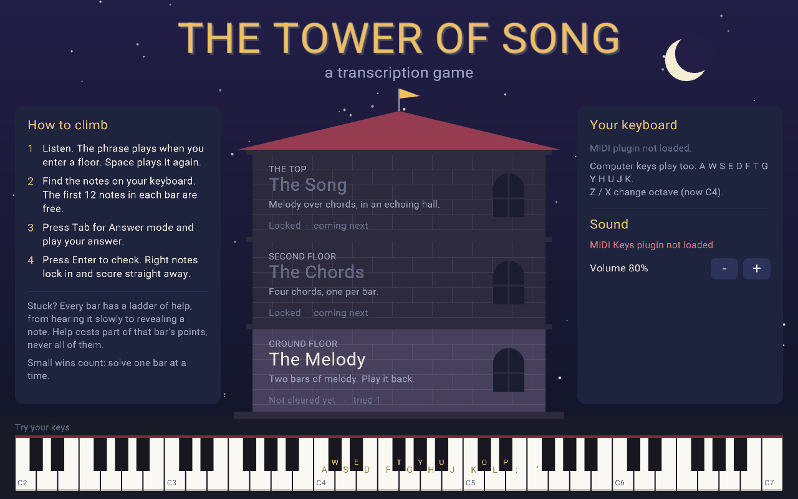
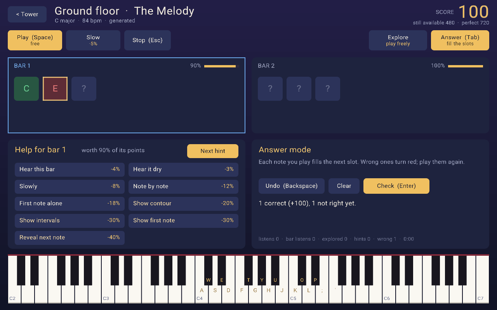

# The Tower of Song

*a transcription game*: hear a phrase, find it on the keys, play it back. The less help you need, the more you score.

Built with [Vectarine](https://vectarineengine.com) 0.7.0 (Luau scripting, hot reload) plus a native plugin, **MIDI Keys**, that adds MIDI keyboard input and a small synth.




## What works now

- **Tower screen**: three floors with best scores. The ground floor is playable; the chords and song floors are locked placeholders. Panels show your MIDI keyboards, audio output and volume. A piano along the bottom lets you try your keys.
- **Ground floor: The Melody.** You hear two bars of a generated melody, then:
  - explore on the keys (12 free notes per bar),
  - press `Tab` for Answer mode and play the notes,
  - press `Enter` to check. Right notes lock in green and score straight away; wrong ones turn red.
- **Help ladder per bar**, from cheap to expensive: hear the bar, hear it dry, slowly, note by note, first note alone, show contour, show intervals, show first note, reveal next note. Whole-phrase Play is free three times; Slow costs a little. Each bar keeps its own share of points (help shrinks it, never below 5%). Solving several notes in one check adds a bonus.
- **Input**: MIDI keyboards (opened automatically, reconnected on hot-plug), computer keys (`A W S E D F T G Y H U J K O L P ; '`, with `Z`/`X` for octave), and mouse on the on-screen piano.
- Best scores persist between runs.

| Key | Action |
|---|---|
| `Space` | play / stop the phrase |
| `Tab` | Explore / Answer mode |
| `Enter` | check (or next puzzle when cleared) |
| `Backspace` | undo the last entry |
| `1` `2` | focus a bar |
| `Esc` | stop, then back to the tower |

## Running it

1. Get the engine: download `vectarine.macos.arm64.zip` from [Vectarine 0.7.0](https://github.com/vanyle/vectarine/releases/tag/0.7.0) and unzip it into `private/vectarine-0.7.0/` (ignored by git). Open `private/vectarine-0.7.0/VectarineEditor.app` and open `game.vecta`.
2. The editor only runs plugins you trust. Open the **Plugin manager**, press *Open plugins folder*, copy `plugins/midi_keys.vectaplugin` into it, and refresh.
3. Edit any `.luau` file and save: the game reloads instantly and keeps your current puzzle.

Without the plugin the game still runs, silently and without MIDI (`scripts/lib/sound.luau` swaps in a stand-in), so `vecta test` and screenshots work.

Exporting needs an **absolute** project path (a relative one exports an empty game):

```bash
private/vectarine-0.7.0/vecta export --project "$PWD/game.vecta" --target mac-os
```

## Layout

```
game.vecta                 manifest (lists the midi_keys plugin)
scripts/game.luau          entry: screens, saving progress
scripts/screens/           title.luau (the tower), play.luau (a melody floor)
scripts/lib/               draw (pixel-space drawing, buttons, palette), sound (plugin wrapper +
                           computer-keyboard piano), keyboard (on-screen piano), theory, melody
                           (generator + playback arrangements), puzzle (rules, help costs, scoring)
plugins/                   midi_keys.vectaplugin (+ the extracted .dylib the runtime loads)
private/                   never exported with the game (Vectarine skips this folder):
  midi_keys/               the plugin's Rust source
  vectarine-0.7.0/         the engine, editor and vecta CLI (not in git; see Running it)
  juce-prototype/          the earlier C++ version (JUCE audio/MIDI, SDL3 + Dear ImGui UI,
                           all three floors). Not maintained; see its own README
test/                      vecta tests and reference screenshots (not exported)
```

Tuning lives in `scripts/lib/puzzle.luau`: `M.HINTS` / `M.LISTEN` (costs) and the constants at the top.

## The MIDI Keys plugin

`require("@vectarine/midi_keys")`. The API with types and docs is in `private/midi_keys/plugin.luau` (also copied to `luau-api/midi_keys.luau` for autocompletion).

| Area | What it provides |
|---|---|
| MIDI input | `poll()`, `held()`, `devices()` |
| Live notes (mouse, computer keys) | `noteOn` / `noteOff` |
| Phrase playback | `playPhrase(notes, "dry" \| "room" \| "hall")` with sample-accurate timing, then `isPlaying`, `playingId`, `position`, `stop` |
| Settings and diagnostics | `setVolume`, `status` |

**Sound**: an additive piano, a synth pad and a bell, plus reverb and echo. Notes from MIDI keyboards sound inside the plugin, so latency doesn't depend on the frame rate.

**Under the hood** (Rust, `private/midi_keys/src`):

| File | What it does |
|---|---|
| `midir` | MIDI. Rescans every 1.5 s; busy ports are retried; unplugging releases stuck notes. |
| `cpal` | Audio output, 256-sample buffer. |
| `rtrb` | Lock-free queues into the audio thread. |
| `voices.rs` / `fx.rs` | The synth and the effects. |

Rebuild and install into the game with:

```bash
private/midi_keys/install.sh
```

It needs Rust 1.99.1 (pinned in `rust-toolchain.toml`: plugins share Rust types with the engine, so the compiler must match) and `uv`. `cargo test --release` in that folder renders a phrase offline. Set `MIDI_KEYS_DEBUG=1` to log start-up and the first call of each function to stderr.

### Two things worth knowing about Vectarine plugins

1. **The plugin must use the engine's Luau, not its own copy.** By default a plugin compiles a second Luau VM into itself. Both copies then work on one Lua state but disagree on Luau's internal static objects (the empty-table marker `dummynode`). Whichever copy runs the garbage collector frees the other's statics, and the game segfaults a few seconds in. `private/midi_keys/.cargo/config.toml` overrides mlua-sys's link step so no Luau is linked; the symbols resolve from the runtime, which exports all of them on macOS (the editor too). The plugin template has the same latent bug; it only shows up once a plugin allocates every frame.
2. **Windows and Linux are not supported yet** for this reason: the 0.7.0 Windows and Linux runtimes don't export Luau's functions, so a plugin there has to carry its own copy and will crash the same way. Fixing it needs an engine change (export the Luau API on every platform, as macOS already does). That's worth raising with the Vectarine maintainers as an issue.

Other notes:

- In `require`, only paths starting with `./` are relative to the current file. Anything else, including `../`, is relative to the project root, so screens use `require("scripts/lib/draw")`.
- `vecta screenshot` captures the first frame, before scripts finish loading. Use a test with `compare_screenshot_to` after `wait_for_frames` instead (see `test/screens.vecta-test.toml`).
- `vecta test` and `vecta screenshot` run games without plugins.

## Tests

```bash
private/vectarine-0.7.0/vecta test --path test
```

Add `-r` to refresh the reference screenshots. The test progress counter ("tried N") is saved between runs, so screenshots differ slightly from run to run.

## Next steps

- Chords floor: the plugin already plays pads and chords; needs chord entry (three or more notes held together) and a chord picker.
- Song floor: melody over chords, in the "hall" effect.
- SoundFont piano (`rustysynth` in the plugin) and the MIDI catalog (cutting phrases from your `.mid` files with `midly`).
- Event log of every action, as in the C++ version.
