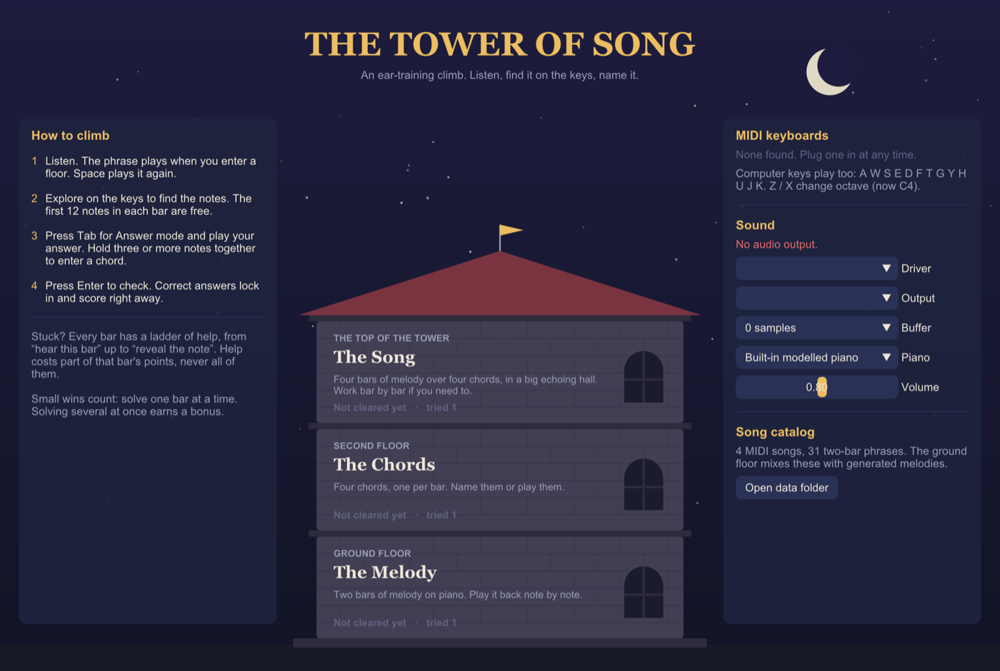
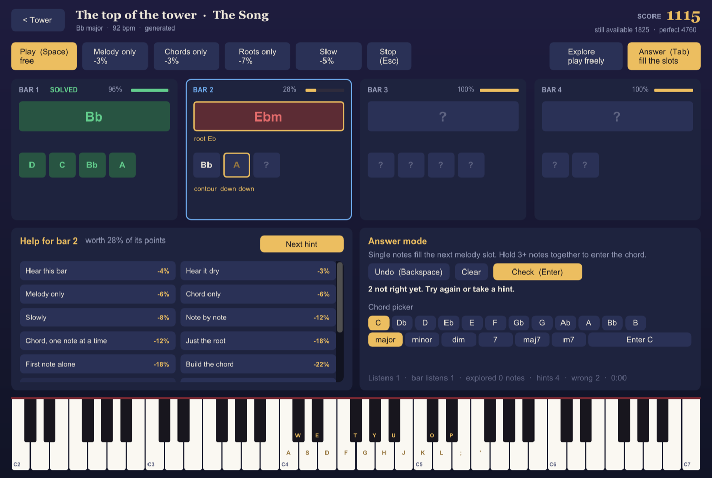

# The Tower of Song

An ear-training game for Windows and macOS. You hear a melody, a chord progression or both, work it out on a MIDI keyboard (or the computer keyboard / mouse), and play it back. You score on how little help you needed, and help never takes all the points, so you always progress by breaking a puzzle into smaller pieces.




## Floors (levels)

| Floor | What plays | You identify | Bars | Points × |
|---|---|---|---|---|
| Ground floor: The Melody | a melody on piano (generated, or cut from the MIDI catalog and transposed) | each note | 2 | 1.0 |
| Second floor: The Chords | 4 diatonic triads, one per bar | each chord | 4 | 1.5 |
| Top: The Song | 4 bars of melody over 4 chords, in a hall with echo | every note and chord | 4 | 2.0 |

The tower screen shows the best score per floor. Progress is saved automatically.

## How a puzzle works

- **Explore mode** (default): play freely to find the notes. The first 12 notes per bar are free; after that each one costs 1% of the selected bar.
- **Answer mode** (`Tab`): single notes fill the next melody slot; three or more notes held together enter a chord (any inversion, any octave). The chord picker enters chords with the mouse. `Backspace` undoes, `Enter` checks.
- Answers are graded on pitch class (the octave doesn't matter); rhythm is never graded.
- Click a bar (or press `1`-`4`) to focus it. Hints apply to the focused bar.

### Scoring

Each slot (note or chord) is worth `100 × floor multiplier × the bar's remaining share`, plus a bonus of 4% per extra slot solved in the same check (up to +40%). Every bar starts at 100%; help multiplies it down, and it never drops below 5%:

| Help | Cost to that bar |
|---|---|
| Play whole phrase | first 3 free, then 2% to every unsolved bar |
| Melody only / chords only / roots only / slow (whole phrase) | 3-7% to every unsolved bar |
| Hear this bar, dry, melody only, chord only, slowly | 3-8% |
| Note by note, chord arpeggiated, first note alone, just the root | 12-18% |
| Build the chord (synth: root, +3rd, +5th) | 22% |
| Show contour / intervals / first note / root / quality | 20-35% |
| Reveal next note (repeatable) / reveal chord | 40% / 55% |
| Wrong check | 10% |

All of these values live in two places: [src/game/Hints.cpp](src/game/Hints.cpp) (the hint table) and the constants at the top of `Puzzle` in [src/game/Puzzle.h](src/game/Puzzle.h).

Everything you do (each note explored, hint, entry, check) is appended to `events.jsonl` in the data folder, one JSON object per line, with the level and puzzle seed.

## Controls

| Key | Action |
|---|---|
| `A W S E D F T G Y H U J K O L P ; '` | piano (C to F, one and a half octaves) |
| `Z` / `X` | computer-keyboard octave down / up |
| `Space` | play / stop the phrase |
| `Tab` | Explore / Answer mode |
| `Enter` | check answers (or next puzzle when solved) |
| `Backspace` | undo the last entry |
| `1`-`4` | focus a bar |
| `Esc` | stop playback, then back to the tower |

MIDI keyboards are opened automatically, hot-plugged, and retried if another app holds them. The on-screen piano also plays with the mouse (drag for glissando).

## Building

Requirements: CMake 3.24+, a C++20 compiler (Xcode command line tools on macOS, Visual Studio 2022 on Windows), Git, and internet access on the first configure. JUCE 9, SDL 3, Dear ImGui and TinySoundFont are downloaded into `.deps/` the first time.

```bash
cmake -S . -B build -DCMAKE_BUILD_TYPE=Release
```

```bash
cmake --build build --config Release --parallel
```

Run it: `build/Tower of Song.app` on macOS, `build\Release\Tower of Song.exe` on Windows.

Tests (theory, generator, arranger, scoring rules, MIDI catalog, offline audio render):

```bash
ctest --test-dir build --build-config Release --output-on-failure
```

`.github/workflows/build.yml` builds and tests both platforms on GitHub Actions.

### Handy flags

`--level N` jumps into a floor, `--seed N` fixes the puzzle, `--demo` pre-fills a mid-game state, `--no-audio` skips the audio device, `--data-dir PATH` uses another save folder, and `--screenshot out.bmp [--frames N]` renders and quits. `tos_tests --wav out.wav` renders a puzzle to a WAV file (`samples/demo_level3.wav` is one).

## Sounds

- **Piano** (default): a built-in additive model (inharmonic partials, two detuned strings, hammer noise). To use a sampled piano, drop any `.sf2` SoundFont into `assets/soundfonts/` (or `soundfonts/` in the data folder) and pick it under *Sound → Piano*. Bank 0 / program 0 is used. Freely licensed options include GeneralUser GS and FluidR3_GM.
- **Synth pad** for roots and chord build-ups, and a **bell** tone, both built in.
- **Effects**: JUCE reverb plus a ping-pong delay. The top floor plays in a hall with echo; "Hear it dry" removes them.

## MIDI catalog

Put `.mid` files in `assets/catalog/` or `catalog/` in the data folder. For each song the game picks the highest, mostly monophonic track, keeps its top voice and cuts bar-aligned phrases (3+ notes, range within an octave and a half). The ground floor uses a catalog phrase half the time, transposed into a random key. `tools/make_example_catalog.py` writes four public-domain tunes as a starting point.

## Data folder

- macOS: `~/Library/Application Support/TowerOfSong/`
- Windows: `%APPDATA%\TowerOfSong\`

It holds `progress.json` (best scores and settings) and `events.jsonl` (the action log). The *Open data folder* button on the tower screen opens it.

## Layout

```
src/engine   audio + MIDI (JUCE, behind a plain C++ interface): voices, effects, phrase scheduler
src/music    theory, question generator, arranger (playback variants), MIDI catalog
src/game     levels, puzzle rules and scoring, hints, saves
src/ui       Dear ImGui screens: tower, play screen, piano keyboard, theme
src/app      SDL3 window, main loop, input routing
tests        unit tests + WAV renderer
```

## Licences

JUCE is dual-licensed under AGPLv3 or the commercial JUCE licence (free tier available under a revenue cap). Check that the licence you choose fits how you plan to distribute the game. SDL is zlib, Dear ImGui and TinySoundFont are MIT.

## Status

Built and tested on macOS (Apple Silicon). The Windows build is configured (WASAPI, ASIO, Windows MIDI Services through JUCE) and runs in CI, but it hasn't been run on a Windows machine yet.
